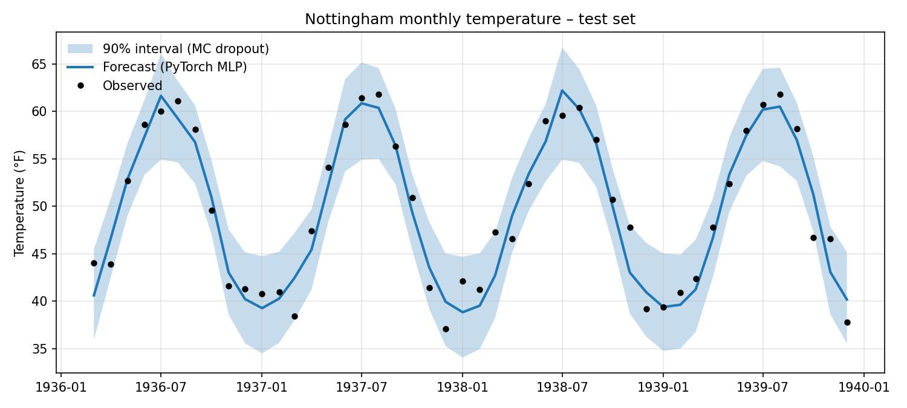
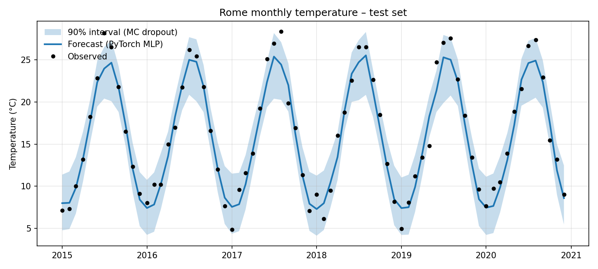

# Bayesian vs Frequentist Neural Networks — Python replication (PyTorch)

Python replication of my MSc thesis ([original R + Stan version](https://github.com/aleksandra-szczurek/bayesian-vs-frequentist-neural-networks)).
I rebuilt the same forecasting network in **PyTorch**, estimated its uncertainty with **MC dropout**, and compared it with the fully Bayesian network (HMC/NUTS in Stan) from the thesis.

**Question:** can a cheap approximation (MC dropout) match a full Bayesian neural network in accuracy and calibrated uncertainty?

## Data and method

- **Data:** monthly temperatures for Nottingham 1920–1939 (`nottem`) and Rome 1990–2020 (NASA POWER, exported from R)
- **Features:** 12 monthly lags + cyclical month encoding (sin/cos) → 14 inputs
- **Split:** chronological 80/20, standardisation fitted on the training set only (no leakage)
- **Model:** feed-forward network, 1 hidden layer with 8 neurons, dropout p = 0.1, Adam, L2 weight decay
- **Uncertainty:** MC dropout (500 forward passes) + observation noise estimated from training residuals
- **Metrics:** RMSE, MAE, 90% interval coverage and mean width

## Results (test set)

| Dataset | Model | RMSE | MAE | 90% coverage | Mean width |
|---|---|---|---|---|---|
| Nottingham | PyTorch MLP + MC dropout | 2.12 | 1.73 | 95.7% | 9.08 °F |
| Nottingham | Bayesian NN (thesis, Stan) | 2.14 | 1.74 | 91.3% | 7.51 °F |
| Rome | PyTorch MLP + MC dropout | 1.56 | 1.23 | 93.1% | 6.22 °C |
| Rome | Bayesian NN (thesis, Stan) | 1.46 | 1.09 | 84.7% | 4.27 °C |




## Key takeaways

- **Accuracy:** MC dropout matched the Bayesian network on Nottingham and came close on Rome (RMSE 1.56 vs 1.46), at a fraction of the computational cost.
- **Uncertainty – a real trade-off:** the Bayesian network gave much sharper intervals (e.g. 4.27 °C vs 6.22 °C on Rome) but under-covered on Rome (84.7% for a 90% target); MC dropout was wider and more conservative, with coverage closer to or above the nominal level.
- **Both models underestimate the summer peaks of 2015–2020 in Rome**, the warmest part of the series: a lag-only model struggles to capture the warming trend. Adding a trend feature is a natural next step.
- **Caveat:** test sets are small (46 and 72 months), so coverage differences of a few points correspond to only a few observations.
- As in the thesis, observation noise dominates predictive uncertainty: without it, MC dropout intervals would be far too narrow.

## How to run

```bash
pip install -r requirements.txt
python main.py
```

## Project structure

```
├── main.py            # runs the full pipeline on both datasets
├── src/
│   ├── data.py        # loading, features, split, scaling
│   ├── model.py       # PyTorch network
│   ├── train.py       # training loop
│   └── evaluate.py    # metrics and MC dropout uncertainty
├── data/rome.csv      # Rome monthly temperatures (NASA POWER, exported from R)
└── results/           # forecast plots
```

## Tools

Python · PyTorch · NumPy · pandas · statsmodels · matplotlib
